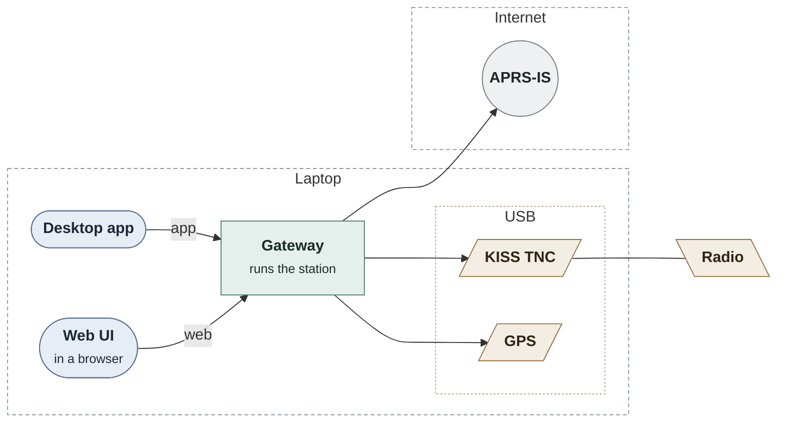
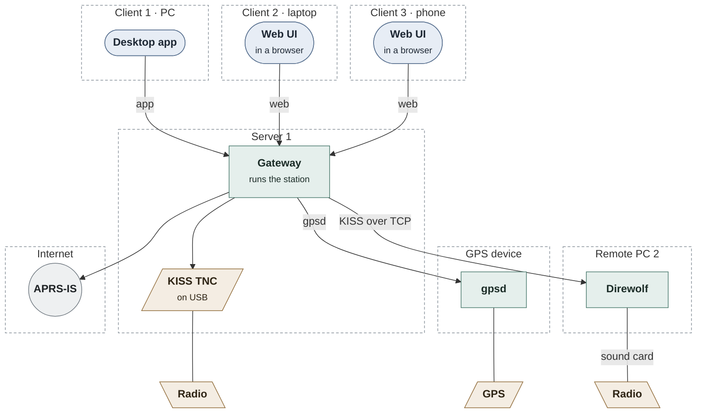
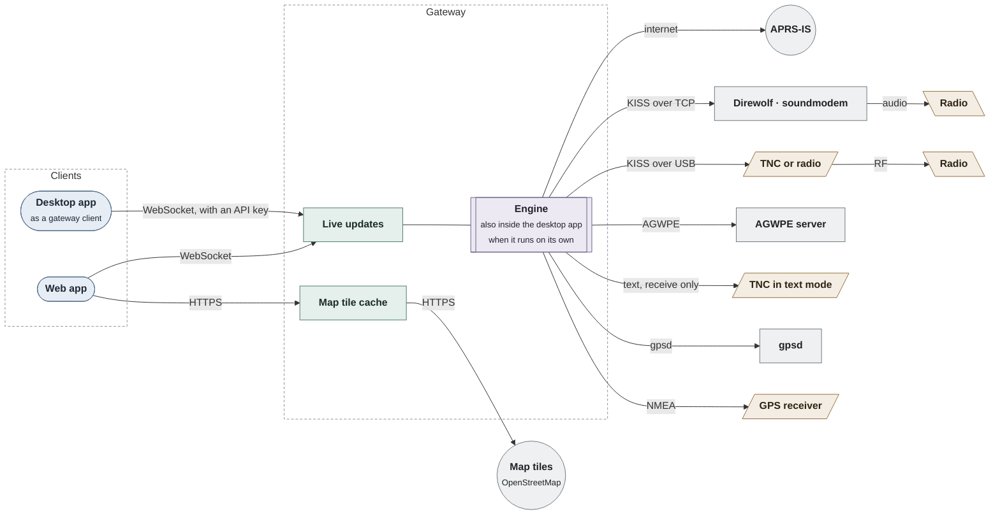

# AprsMap

[](https://github.com/APRS-NET/AprsMap/actions/workflows/ci.yml)
[](https://github.com/APRS-NET/AprsMap/actions/workflows/packages.yml)
[](#code-coverage)
[](https://ai-declaration.md)

An APRS map client for amateur radio, built on .NET 10 and Avalonia: a native desktop app for Windows, Linux and
macOS, and a web app served by a Docker gateway, both running the same UI on the same engine. APRS protocol work comes
from [APRS.NET](https://github.com/APRS-NET/APRS.NET). The feature set is a clean-room reimplementation of the
functionality of APRSIS32, redesigned with a modern UI (see [docs/clean-room.md](docs/clean-room.md)).

Status: `0.8.0-alpha.1`. The app receives and transmits over APRS-IS and your own TNCs: KISS over TCP (Direwolf,
soundmodem), on serial ports (a TH-D72A's built-in TNC, TNC-X, NinoTNC) and through an AGWPE server, or a TNC's text
output. It shows the stations on a live map with their tracks, RF paths and dead-reckoned positions, with station and
packet lists, station details and a dashboard for every source or each one, on the desktop and in the browser. Every
packet is kept for up to 7 days within a size limit, so stations and tracks come back after a restart, a station's
track and packets go back days, the dashboard covers a week, and the map can add the stations heard in the last days.
Licensed operators send their position by hand or as a beacon (fixed, decaying, or SmartBeaconing from a GPS),
statuses, objects and items, messages with acks and auto-replies, ANSRVR group conversations, and answer APRS queries.
Their TNCs can digipeat (fill-in or wide-area) and act as a two-way IGate. A GPS on serial, TCP, gpsd or a radio's TNC
port places the station, with a sky view and statistics over time. Station lists and saved filters bring back an
event's volunteers or the spotters you work with in one click, wherever they are. The gateway runs as a Linux service
that updates itself, and the desktop app can be its client with an API key; every release carries an SBOM.
Next is transmitting with the registered TOCALL.
See [docs/status.md](docs/status.md) for what
to expect when you run it, and [docs/scope.md](docs/scope.md) for the plan.

> [!WARNING]
> **Alpha software.** Every release is an alpha pre-release (`0.x.y-alpha.N`) until at least v1.0.0. Behaviour and
> settings can change between any two releases. It depends on APRS.NET alpha packages, which change often too.

## Download

| App | Get it |
| --- | --- |
| Desktop | [GitHub releases](https://github.com/APRS-NET/AprsMap/releases): `win-x64`, `win-arm64`, `linux-x64`, `linux-arm64`, `osx-x64`, `osx-arm64` archives. Self-contained, no .NET install needed. Unsigned for now. |
| Web (gateway) | `docker run -p 8080:8080 ghcr.io/aprs-net/aprsmap:alpha`, then open <http://localhost:8080>. Multi-arch (`linux/amd64`, `linux/arm64`). See [docs/deployment.md](docs/deployment.md). |

Without a passcode the app logs in to APRS-IS receive-only, and nothing is transmitted.

## How it fits together

One engine and one UI, with two ways to run them. The desktop app can run the engine itself, or connect to a gateway
and show that gateway's station. The web app always uses a gateway, because a browser can't open TCP sockets or serial
ports. Either way the UI calls the same `IEngineService`, so the desktop and web apps behave the same. More detail is
in [docs/architecture.md](docs/architecture.md).

### On one laptop

Everything on one machine: the gateway runs the station with a TNC and a GPS on USB, the desktop app connects to it,
and a browser on the same laptop can show the web UI too.



The desktop app can also run the station itself, with no gateway: then it talks to the TNC and GPS directly, and
there's no web UI.

### Spread over several machines

The station runs on a server, the radios and the GPS can be anywhere on the network, and everyone else connects to
the server. They all see the same station live. Viewing can be open on the LAN, but anything that transmits needs a
signed-in operator, or an API key with operator rights.



### Connections

Clients reach the gateway on the left. The links to the radios and services on the right are the same whichever host
runs the engine.



## Layout

| Path | Contents | Licence |
| --- | --- | --- |
| `src/AprsMap.Contracts` | `IEngineService`, the data types the UIs see, product identity (`Brand`) | MIT |
| `src/AprsMap.Core` | The engine: APRS-IS connection, packet handling (APRS.NET), recent history, telemetry | MIT |
| `src/AprsMap.Client.Remote` | `IEngineService` over SignalR, used by the browser app | MIT |
| `src/AprsMap.UI` | Shared Avalonia views, view models, theme tokens and appearance settings | AGPL-3.0 |
| `src/AprsMap.Desktop` | Desktop app; runs the engine in-process | AGPL-3.0 |
| `src/AprsMap.Browser` | Web app (WebAssembly); talks to the gateway | AGPL-3.0 |
| `src/AprsMap.Gateway` | ASP.NET Core gateway: engine, SignalR hub, browser app, `/healthz`, `/source` | AGPL-3.0 |
| `src/AprsMap.Hosting` | Host wiring shared by the desktop app and the gateway (engine config, OpenTelemetry) | AGPL-3.0 |
| `tests/` | xUnit v3 tests: engine, gateway end to end over SignalR, headless UI | as tested project |
| `docs/` | Scope, architecture, UX and mockups, clean-room process, APRS.NET gaps | MIT |

## Build

```sh
dotnet tool restore
dotnet build
dotnet test
```

Run the desktop app with `dotnet run --project src/AprsMap.Desktop`, or the gateway with
`dotnet run --project src/AprsMap.Gateway` (APRS-IS settings are in each project's `appsettings.json`, section
`Engine`).

The browser app builds with any .NET 10 SDK, but only a **publish** links SkiaSharp into WebAssembly, which needs the
`wasm-tools` workload (`dotnet workload install wasm-tools`, with Microsoft's SDK). The Dockerfile does this, so the
easiest way to try the web app is `docker compose up --build`. Running `src/AprsMap.Browser` on its own doesn't work (the page says so): it needs a
gateway to serve it (see [docs/status.md](docs/status.md#web-app)).

Code is formatted with [CSharpier](https://csharpier.com), and CI fails on unformatted files. Enable the pre-commit hook
once per clone so staged files are formatted when you commit:

```sh
git config core.hooksPath .githooks
```

### Conventions the build enforces

- **Warnings are errors**, with the latest recommended analyzers and code style enforced in the build.
- **Licence headers**: every C# file starts with its project's SPDX line (`.editorconfig`, IDE0073), and an MIT project
  that references an AGPL project fails the build (`Directory.Build.targets`). See [LICENSING.md](LICENSING.md).
- **Banned APIs** ([BannedApiAnalyzers](https://github.com/dotnet/roslyn-analyzers/blob/main/src/Microsoft.CodeAnalysis.BannedApiAnalyzers/BannedApiAnalyzers.Help.md)),
  shared with APRS.NET: `BannedSymbols.txt` (real clocks, blocking waits) for all shipped code,
  `BannedSymbols.Engine.txt` for the MIT engine (no console, no UI, no raw `HttpClient`), and `BannedSymbols.UI.txt` for
  Avalonia projects (no literal colours: theme tokens only, see [docs/ux/README.md](docs/ux/README.md)).
- **Central package versions** in `Directory.Packages.props`; packages come only from nuget.org (`nuget.config`).
- **Product name in one place**: `build/Branding.props`; see [docs/branding.md](docs/branding.md).

## Telemetry

Nothing is sent anywhere by default. Set `OTEL_EXPORTER_OTLP_ENDPOINT` (and any standard `OTEL_*` variables) to export
logs, metrics and traces over OTLP from the desktop app or the gateway. Exported meters and activity sources:

| Name | From | Metrics |
| --- | --- | --- |
| `AprsMap.Core` | The engine | `aprsmap.packets.received` (by packet type), `aprsmap.lines.rejected`, `aprsmap.connection.failures`, `aprsmap.gps.fix.time` (seconds by fix: 3d, 2d, none, silent) and `aprsmap.gps.fix.losses` for the GPS in use, `aprsmap.digipeated`; an `aprs-is.session` trace per connection |
| `AprsNet.*` | APRS.NET, today `AprsNet.AprsIsTcpClient` | `aprsnet.aprsis.lines.received` (packets and server comments), `…packets.received` (by type and outcome), `…packets.parse_failures` (by reason), `…connection.attempts`, `…connection.reconnects`, `…connection.active`, `…login.results`, `…packets.dropped`, `…connection.idle_timeouts` |
| runtime, HTTP client (and ASP.NET Core on the gateway) | OpenTelemetry instrumentation | The standard .NET ones |

To watch them while developing (for example in Rider), either:

- run a local OTLP dashboard, such as `docker run --rm -p 18888:18888 -p 4317:18889 mcr.microsoft.com/dotnet/aspire-dashboard`,
  and add `OTEL_EXPORTER_OTLP_ENDPOINT=http://localhost:4317` to the run configuration's environment; open
  <http://localhost:18888> (the login token is in the container's log); or
- without exporting anything, attach `dotnet-counters` (`dotnet tool install -g dotnet-counters`):
  `dotnet-counters monitor -n aprsmap --counters AprsMap.Core,AprsNet.AprsIsTcpClient`.

## Code coverage

The CI `coverage` job fails if the merged line or branch coverage of the MIT engine (`AprsMap.Contracts`,
`AprsMap.Core`, `AprsMap.Client.Remote`) drops below `MIN_LINE` / `MIN_BRANCH` in `.github/workflows/ci.yml`
(currently 85% line, 80% branch). To see the same numbers locally:

```sh
dotnet tool restore
dotnet test --collect:"XPlat Code Coverage" --results-directory coverage
dotnet reportgenerator -reports:"coverage/**/coverage.cobertura.xml" -targetdir:coverage/report \
  -reporttypes:"Html;TextSummary" -assemblyfilters:"+AprsMap.Contracts;+AprsMap.Core;+AprsMap.Client.Remote"
```

## Package checks

The `packages` workflow lists vulnerable NuGet packages (direct and transitive) and available updates, posts the report
to the run summary and to pull requests, and fails on any known vulnerability. Dependabot proposes updates daily for
NuGet (so each APRS.NET alpha arrives quickly) and weekly for GitHub Actions, the Docker base images and the SDK.

## Releases

[release-please](https://github.com/googleapis/release-please) keeps a release PR open on `main`; merging it tags
`vX.Y.Z`, and the `release` workflow attaches the desktop archives and pushes the container image. Versions come from
the tag through [MinVer](https://github.com/adamralph/minver). The series starts at `0.1.0-alpha.1`, and a new
milestone starts with a `Release-As:` footer on a new commit. See [docs/versioning.md](docs/versioning.md).

## Documentation

| Document | Contents |
| --- | --- |
| [docs/clean-room.md](docs/clean-room.md) | Which sources may and may not be used, and how provenance is recorded |
| [docs/architecture.md](docs/architecture.md) | Projects, the desktop/web split, the gateway, the APRS.NET ownership rule |
| [docs/reference/](docs/reference/) | Behavioural analysis of the reference app from public docs and observation |
| [docs/ux/](docs/ux/) | UX direction, visual style, appearance options, and the approved mockups |
| [docs/scope.md](docs/scope.md) | Phased feature inventory |
| [docs/aprsnet/gaps.md](docs/aprsnet/gaps.md) | Capabilities to be built in APRS.NET, one issue each |
| [docs/features/](docs/features/) | Per-feature specs (the implementation's only behavioural input) |
| [docs/branding.md](docs/branding.md) | How the product name is kept in one place and renamed |
| [docs/status.md](docs/status.md) | What works today, what you'll see when you run it, and known issues |
| [docs/deployment.md](docs/deployment.md) | Running the gateway container and the desktop archives |
| [docs/versioning.md](docs/versioning.md) | Versions, commit types and the release flow |

## AI assistance

AprsMap is developed with an AI coding assistant (Claude Code) as a copilot: the maintainer directs the work, and the
assistant carries out whole tasks, asking for decisions and permission as it goes. The maintainer reviews and merges
every change. See [AI-DECLARATION.md](AI-DECLARATION.md).

## Licence

The repository is AGPL-3.0-only ([LICENSE](LICENSE)). The engine (`AprsMap.Contracts`, `AprsMap.Core`,
`AprsMap.Client.Remote`) and the docs are MIT so other tools can reuse them. Details: [LICENSING.md](LICENSING.md).

APRSIS32 and APRSISCE are the work of Lynn Deffenbaugh, KJ4ERJ. This project is unaffiliated and uses none of its code
or assets. Its published AGPL source is deliberately not consulted; see [docs/clean-room.md](docs/clean-room.md).
